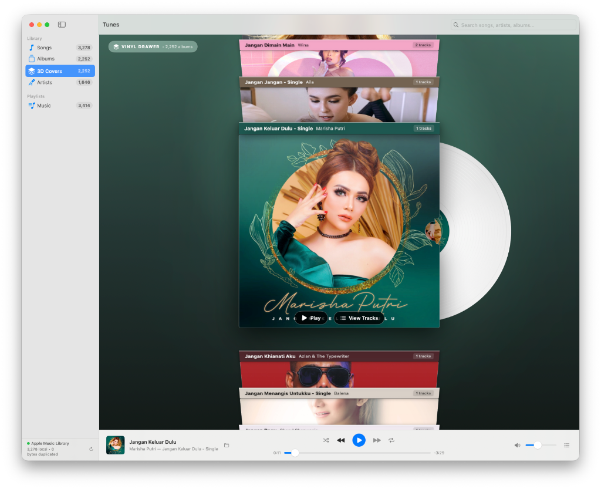
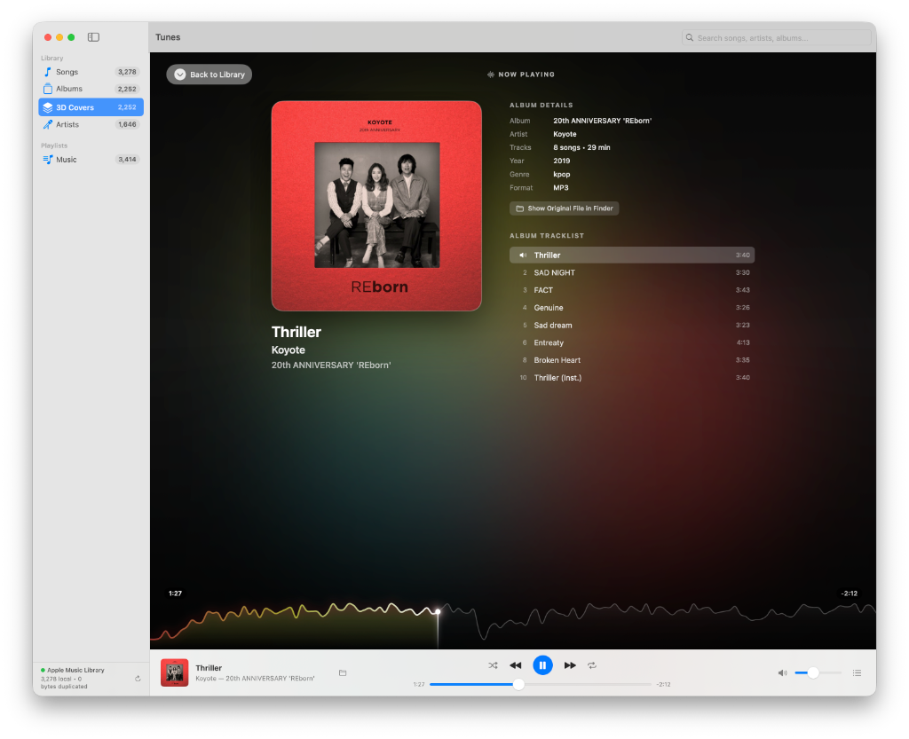
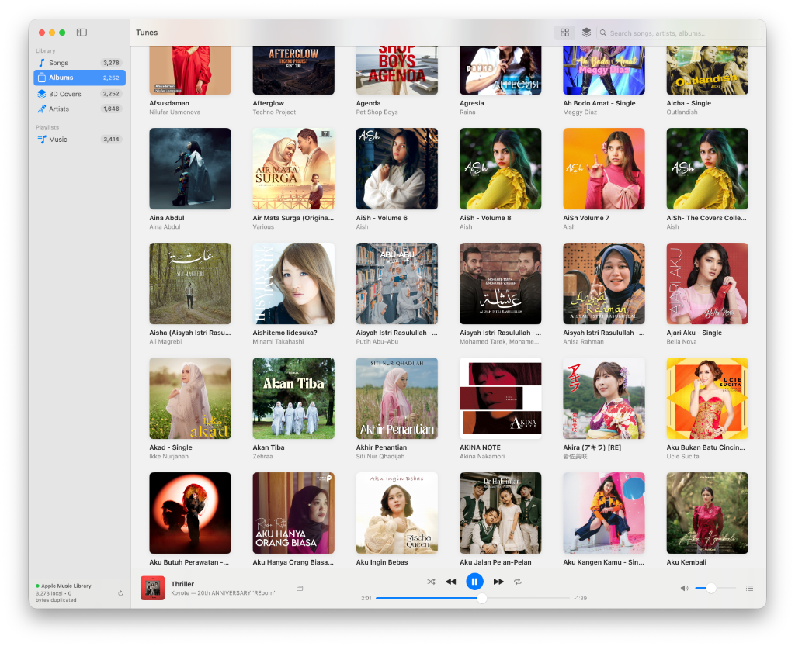

# Spindle

A fast, lightweight, and tactile native macOS music player built with SwiftUI. **Spindle** is designed for music lovers who appreciate the physical experience of vinyl and album sleeves while seamlessly interfacing with their local **Apple Music Library** with **zero storage duplication**.

<p align="center">
  
</p>

---

## Direct Apple Music Library Integration

Spindle connects directly to your existing Apple Music library using macOS's native `iTunesLibrary.framework` (`ITLibrary`):

- **Zero Database Duplication**: Spindle reads song metadata, album titles, artists, genres, track sequencing, and playlists directly from your existing Apple Music database.
- **Zero Audio Duplication**: Playback streams directly from original audio files on your disk (including external hard drives and network storage) via `AVFoundation`.
- **Zero Artwork Duplication**: Leverages cached album art directly from Apple Music's cache with fast $O(1)$ persistent ID lookups and hardware-accelerated downsampling.
- **Local & Lossless Playback**: Full native support for local MP3, AAC, ALAC (Apple Lossless), FLAC, WAV, AIFF, and purchased music files. *(FairPlay DRM-protected subscription streams are excluded as they cannot be decoded outside Apple's proprietary playback sandbox).*

---

## Key Features

### 3D Vinyl Drawer
- **Physical Perspective Stack**: An interactive vertical stack of album jackets tilted in true 3D space, inspired by browsing physical vinyl records in a collector's drawer.
- **Die-Cut Sleeve Thumb Notch**: Features an authentic die-cut thumb cut-out on the right jacket opening, revealing the inner sleeve and vinyl grooves.
- **Spinning White Vinyl LP**: On playback, a pearlescent white vinyl record with micro-etched concentric sound grooves and custom center label smoothly slides out from the sleeve and spins.
- **Dynamic Ambient Backdrop**: The entire drawer view background dynamically morphs to reflect the palette of the currently playing album, complete with a luminous atmospheric spotlight aura.
- **Tactile Spine Navigation**: Click any album to smoothly center it in the viewport with spring physics and automatic viewport alignment.

---

### Expanded Now Playing & Spectrogram Seeker

<p align="center">
  
</p>

- **Waveform Spectrogram Seeker**: Visualizes the track's audio profile via high-resolution RMS audio analysis, revealing a smooth Catmull-Rom spline curve that doubles as an interactive scrubbing seeker.
- **Dynamic Living Motion Gradients**: Ambient fluid lighting that shifts subtly with the music.
- **Minimal, Typography-First Details**: Left-aligned tracklist and metadata without clutter or monospace typefaces.

---

### Library Browsing & System Integration

<p align="center">
  
</p>

- **Library Views**:
  - **3D Covers**: Interactive physical vinyl drawer browser.
  - **Albums**: Responsive cover grid with instant album detail inspection.
  - **Songs**: Searchable, sortable list view with real-time filtering.
  - **Artists**: Two-pane discography navigator.
  - **Playlists**: Preserves custom playlist order directly from Apple Music.
- **Media Keys & Control Center**: Full integration with `MPRemoteCommandCenter` (Play/Pause, Next, Previous, Scrubbing) and Touch Bar/keyboard media keys (F7, F8, F9).
- **Now Playing Info Center**: Publishes active song title, artist, album, duration, elapsed playback time, and artwork to macOS Control Center and lock screen.
- **Reveal in Finder**: Quickly jump straight to the source audio file in Finder.

---

## Keyboard Shortcuts

| Shortcut | Action |
| :--- | :--- |
| `Space` | Play / Pause |
| `Cmd + Right Arrow` | Next Track |
| `Cmd + Left Arrow` | Previous Track |
| `Cmd + Shift + S` | Toggle Shuffle |
| `Cmd + Shift + R` | Cycle Repeat Mode (Off / All / One) |

---

## Building from Source

### Prerequisites
- macOS 14.0 (Sonoma) or later
- Xcode 15+ / Command Line Tools with Swift 5.9+

### Build & Package Application
Compile the release binary, generate the high-resolution turntable app icon, and assemble the standalone `.app` bundle:

```bash
./scripts/build_app.sh
```

The output will be placed at `build/Tunes.app`. You can drag it to `/Applications` or open it directly:

```bash
open build/Tunes.app
```

### Swift Package Manager
To build the raw binary directly with SPM:

```bash
swift build -c release
```

---

## Architecture & Project Structure

```
spindle/
├── Package.swift                  # Swift Package Manager manifest
├── docs/
│   └── screenshots/               # App showcase screenshots
│       ├── vinyl-drawer.png
│       ├── now-playing.png
│       └── albums-grid.png
├── Sources/
│   └── Tunes/
│       ├── App.swift              # App lifecycle & global keyboard commands
│       ├── Models/
│       │   ├── Song.swift         # Song model wrapping ITLibMediaItem
│       │   ├── Album.swift        # Album hierarchy & sorting
│       │   ├── Artist.swift       # Artist discography grouping
│       │   └── Playlist.swift     # Playlist representation
│       ├── Services/
│       │   ├── LibraryManager.swift     # iTunesLibrary loader & search index
│       │   ├── AudioPlayer.swift        # AVPlayer & MPRemoteCommandCenter
│       │   ├── ArtworkLoader.swift      # $O(1)$ artwork cache & palette extractor
│       │   └── AudioSpectrogramLoader.swift # AVAssetReader audio wave analyzer
│       └── Views/
│           ├── ContentView.swift        # NavigationSplitView & sidebar
│           ├── CoverStackView.swift     # 3D Vinyl Drawer view
│           ├── ExpandedNowPlayingView.swift # Full-screen now playing experience
│           ├── AlbumsGridView.swift     # Standard album grid
│           ├── AlbumDetailView.swift    # Album tracklist & details
│           ├── SongsListView.swift      # Sortable song library table
│           ├── ArtistsView.swift        # Artist discography view
│           ├── PlaylistDetailView.swift # Playlist tracklist
│           ├── NowPlayingBar.swift      # Bottom transport bar & album thumbnail
│           ├── QueuePopoverView.swift   # Up Next queue popover
│           └── Components/
│               ├── AlbumSlabView.swift  # 3D album slab with notch cutout
│               ├── VinylDiscView.swift  # Spinning pearlescent white LP disc
│               └── SpectrogramSeekerView.swift # Catmull-Rom spline wave seeker
├── Resources/
│   ├── Info.plist                 # Bundle metadata & permissions
│   └── AppIcon.icns               # Top-down turntable app icon
└── scripts/
    ├── build_app.sh               # Build, bundle, and sign script
    └── generate_icon.swift        # App icon generator
```

---

## License

MIT License. See [LICENSE](LICENSE) for details.
